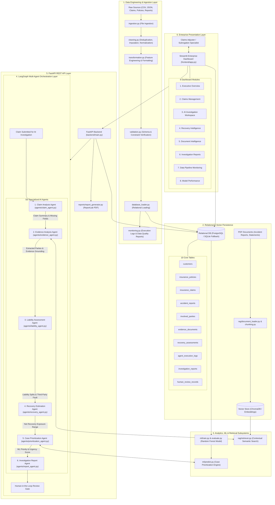
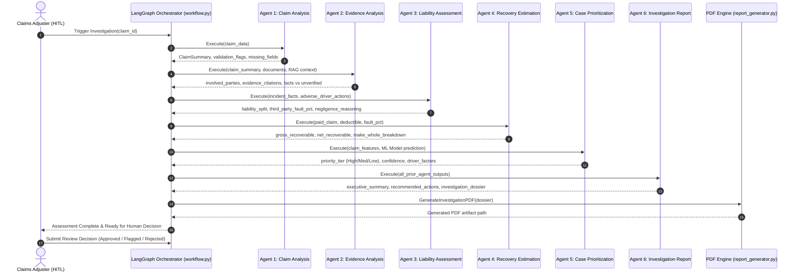

# SubroRecover AI — System Architecture Specification

## 1. Executive Summary & Architectural Overview

**SubroRecover AI** is an enterprise-grade, agentic insurance intelligence system engineered to accelerate and automate the subrogation investigation lifecycle for Property & Casualty (P&C) and Commercial Auto insurance carriers.

### The Subrogation Challenge
Subrogation represents the carrier's right to pursue liable third parties for losses paid out to insured policyholders. In practice:
- Billions of dollars in viable recovery are lost annually ("subrogation leakage") due to manual triage bottlenecks.
- Adjusters spend weeks manually reading police accident narratives, repair invoices, and witness accounts.
- Statute of Limitations (SOL) deadlines are tracked inconsistently.
- Estimations of comparative negligence and financial quantum lack objective data grounding.

### The SubroRecover AI Solution
SubroRecover AI is built as a **Decision-Support and Investigation Acceleration Platform**:
- Automated ETL pipeline transforming heterogeneous claim feeds into normalized analytical schemas.
- Dual-database resilience (PostgreSQL production-ready with zero-config SQLite development fallback).
- Supervised Machine Learning model (Random Forest) for predictive case prioritization.
- Contextual Document RAG engine (PyPDF + ChromaDB) for grounded evidentiary fact extraction.
- LangGraph-orchestrated 6-Agent AI system providing explainable, multi-dimensional claim assessments.
- FastAPI REST backend serving claims, assessments, telemetry, and reporting endpoints.
- Streamlit enterprise dashboard delivering an 8-page command center for adjusters and executives.
- ReportLab-powered automated 14-section court-ready Subrogation Investigation PDF generation.

---

## 2. End-to-End System Architecture

---

## 3. Multi-Agent Orchestration Workflow (LangGraph)

The platform implements six specialized cooperative agents orchestrated via **LangGraph**:

---

## 4. Architectural Component Responsibilities

### 4.1 Data Engineering (`data_engineering/`)
- `ingestion.py`: Connectors for CSV, JSON, and raw claim feeds.
- `cleaning.py`: Deduplication, missing value imputation, data type casting, date normalization.
- `transformation.py`: Derived feature creation (recovery percentages, days-to-report, party ratios).
- `validation.py`: Business rule constraint assertions (paid_amount > 0, valid policy dates).
- `database_loader.py`: Batch relational loaders with transaction safety and UPSERT capability.
- `monitoring.py`: ETL job telemetry, processing throughput, error counters, and quality summaries.
- `pipeline.py`: Master ETL orchestrator coordinating extraction, transformation, validation, and loading.

### 4.2 Database Layer (`database/`)
- `schema.sql`: DDL defining all 10 relational tables, indexes, check constraints, and foreign key cascades.
- `connection.py`: Resilient SQLAlchemy engine manager auto-selecting PostgreSQL (when reachable) or local SQLite (`subro_recover.db`).

### 4.3 Machine Learning (`ml/`)
- `train.py`: Trains a Scikit-learn Random Forest classifier on historical claim recovery profiles.
- `evaluate.py`: Generates test set confusion matrix, classification report, ROC-AUC score, and feature importances.
- `predict.py`: Reusable inference pipeline providing priority scores and explainability factors.
- `models/`: Serialized model binaries (`rf_priority_model.joblib`) and metadata.

### 4.4 RAG Document Intelligence (`rag/`)
- `document_loader.py`: PDF document parser extracting text with layout awareness.
- `chunking.py`: Semantic chunker with configurable token overlap to preserve incident context.
- `embeddings.py`: Vector embeddings generator supporting ChromaDB integration.
- `retriever.py`: Context-grounded retriever returning top matching excerpts with source citations.

### 4.5 Agentic AI Layer (`agents/`)
- `claim_agent.py`: Validates coverage, verifies paid claim limits, flags deductible gaps.
- `evidence_agent.py`: Audits police narratives, identifies citations, cross-references statements.
- `liability_agent.py`: Evaluates comparative fault split based on statutory negligence rules.
- `recovery_agent.py`: Computes net recoverable quantum with Make-Whole policyholder protection.
- `prioritization_agent.py`: Applies ML model scores and assigns investigation urgency tiers.
- `report_agent.py`: Compiles unified findings, missing data checklists, and actionable recommendations.
- `workflow.py`: LangGraph state machine coordinating linear and conditional agent workflows.

### 4.6 Backend API (`backend/`)
- `main.py`: FastAPI application entrypoint with CORS, logging middleware, and health endpoints.
- `api/`: REST routing modules for claims, documents, investigation triggers, reports, analytics, and telemetry.
- `schemas/`: Pydantic validation schemas for API inputs and responses.
- `services/`: Business services connecting agents, DB, ML, and PDF generator.

### 4.7 Frontend Dashboard (`frontend/`)
- `app.py`: Streamlit multi-page enterprise dashboard entry point.
- `pages/`: 8 purpose-built adjuster and management modules with Plotly analytics.
- `components/`: Reusable enterprise UI cards, tables, badges, and callouts.
- `assets/`: Custom enterprise CSS styling adhering strictly to corporate design guidelines.

### 4.8 Reporting (`reports/`)
- `report_generator.py`: Generates official, multi-page Subrogation Investigation Reports via ReportLab with corporate branding, tables, metrics, and human sign-off blocks.

---

## 5. Security, Privacy & Design Safeguards

1. **Zero Secret Leakage:** Database credentials and LLM keys are accessed exclusively via `.env`.
2. **Transparent Local Fallbacks:** System operates seamlessly offline without external API dependencies.
3. **Auditability:** Every agent execution, state mutation, and human decision is persisted with timestamps.
4. **Human Governance:** AI outputs are presented strictly as decision-support intelligence.
