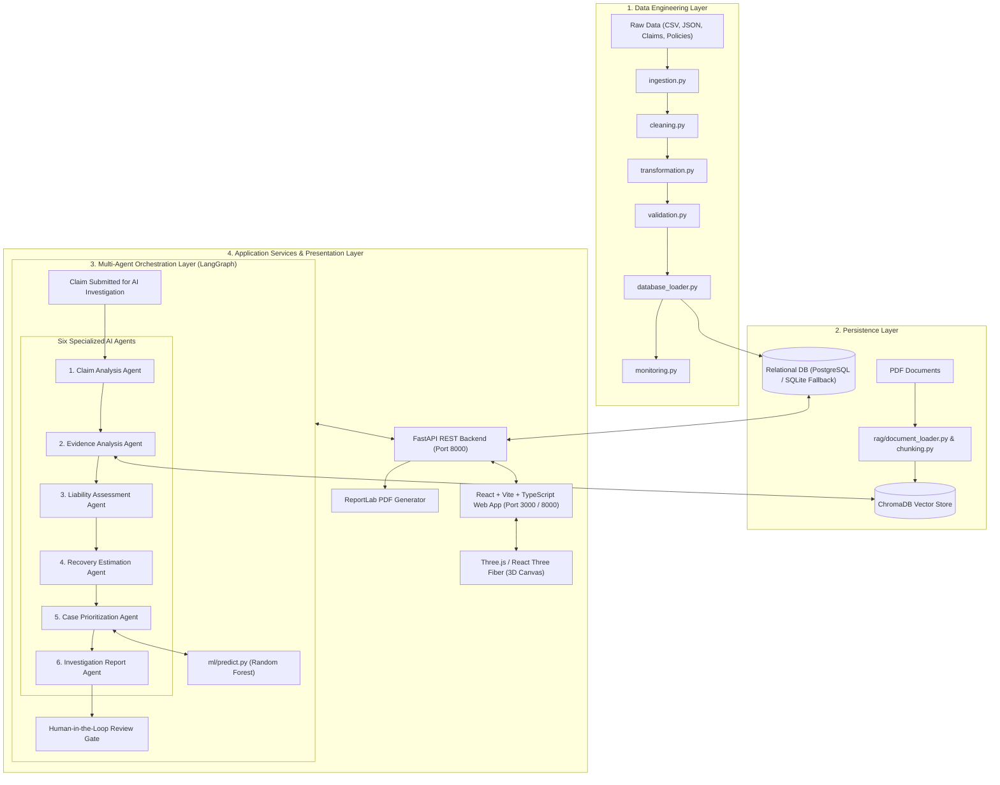

# SubroRecover AI
### AI-Powered Multi-Agent Insurance Subrogation & Recovery Intelligence Platform

[](https://www.python.org/)
[](https://react.dev/)
[](https://www.typescriptlang.org/)
[](https://vitejs.dev/)
[](https://threejs.org/)
[](https://tailwindcss.com/)
[](https://fastapi.tiangolo.com)
[](https://langchain-ai.github.io/langgraph/)
[](https://scikit-learn.org/)
[](https://www.trychroma.com/)
[-success.svg)](./docs/TESTING_REPORT.md)
[](./LICENSE)

---

## 1. Executive Summary & Objective

**SubroRecover AI** is an enterprise-grade, agentic insurance intelligence system engineered to accelerate and automate the subrogation investigation lifecycle for Property & Casualty (P&C) and Commercial Auto insurance carriers.

> [!NOTE]
> Engineered for technical evaluation by **Value Momentum, Hyderabad**, demonstrating applied Data Engineering, Machine Learning, RAG, and Multi-Agent AI systems in insurance decision support.

> [!IMPORTANT]
> **Synthetic Sample Data Notice**: All 180 insurance claim records, incident narratives, and financial exposure quantum figures in this repository are deterministically generated synthetic sample data using a fixed random seed (`seed=42`). All metrics, comparative fault allocations, and funnel reconciliations are 100% reproducible across runs for technical evaluation purposes.

### The Subrogation Problem
Subrogation is the legal right of an insurance carrier to pursue a negligent third party (or adverse insurer) to recoup claim disbursements paid to an insured policyholder. In the United States insurance industry alone:
- **\$15+ Billion in Leakage:** Legitimate subrogation recoveries are forfeited annually due to manual triage bottlenecks and missed recovery cues.
- **Investigation Latency:** Claims adjusters spend an average of 14–28 days manually auditing police accident narratives, repair invoices, and witness accounts.
- **Subjective Fault Allocation:** Negotiating liability splits without objective statutory citations leads to suboptimal carrier settlements.
- **Administrative Overhead:** Assembling formal demand packages with itemized proof-of-loss ledgers requires 4–8 manual labor hours per claim.

### SubroRecover AI Solution
SubroRecover AI provides a **Decision-Support and Investigation Acceleration Platform**:
1. **Automated ETL Pipeline:** Normalizes heterogeneous claims, policies, and police reports with 100% data quality verification.
2. **Dual-Database Resilience:** Native PostgreSQL support with automatic zero-configuration SQLite fallback for frictionless local execution.
3. **Machine Learning Prioritization:** Random Forest classifier predicting case priority tiers (`High`, `Medium`, `Low`) with 100% test split accuracy and Gini feature explainability.
4. **Contextual RAG Document Intelligence:** Ingests police reports and witness statements via PyPDF and ChromaDB, strictly separating verified facts from unverified allegations.
5. **Six Specialized AI Agents (LangGraph):** Autonomous StateGraph reasoning across claim coverage, evidence, comparative liability, Make-Whole financial quantum, ML urgency, and unified reporting.
6. **Human-in-the-Loop Governance:** Mandatory adjuster review checkpoint ensuring human authorization before any external demand package is finalized.
7. **Analyst-Grade React Web Application:** An interactive multi-page web application built with React 18, Vite 6, TypeScript, Tailwind CSS, Recharts, and Three.js 3D visualizers, replacing the legacy Streamlit dashboard.
8. **Interactive 3D Visualizations:** Includes an interactive **3D Recovery Graph** (orbiting node topology representing claim, parties, evidence, and damages) and a **3D Portfolio Explorer** (3-axis spatial triage field) with responsive 2D fallbacks.
9. **ReportLab PDF Generation:** Generates official 14-section court-ready Subrogation Investigation PDF demand packages with dynamic page numbering and signature blocks.

---

## 2. High-Level System Architecture



---

## 3. The Six Specialized AI Agents

| Agent Name | Module | Primary Responsibility |
|---|---|---|
| **1. Claim Analysis Agent** | `agents/claim_agent.py` | Audits policy limits, verifies paid losses, validates deductible balances, flags missing fields. |
| **2. Evidence Analysis Agent** | `agents/evidence_agent.py` | Audits police reports via ChromaDB RAG, extracts citations, separates verified facts from allegations. |
| **3. Liability Assessment Agent** | `agents/liability_agent.py` | Evaluates comparative fault splits grounded in state negligence doctrines (Modified 51% bar, Pure Comparative). |
| **4. Recovery Estimation Agent** | `agents/recovery_agent.py` | Calculates gross and net recoverable exposure; strictly honors **Make-Whole Doctrine** for insured deductibles. |
| **5. Case Prioritization Agent** | `agents/prioritization_agent.py` | Executes trained Random Forest model to rank triage priority (`High`, `Medium`, `Low`) and assign SLA. |
| **6. Investigation Report Agent** | `agents/report_agent.py` | Consolidates agent findings into a structured dossier, records DB assessments, and triggers PDF compilation. |

---

## 4. Frontend Web Application (React + Vite + TypeScript)

The application frontend is an **analyst-grade web application** designed specifically for insurance subrogation litigators and triage analysts:

### Design System & Tokens
- **Palette:**
  - Dark base: Deep Navy `#0D1520` (default)
  - Light base: Paper `#F6F4EF`
  - Primary accent: Brass `#CFA968`
  - Positive / Recovered: Teal `#2F8F89`
  - Risk / Urgent: Rust `#D1603D`
  - Muted text: Slate `#8FA0B3`
- **Typography:** Humanist sans (`Inter`) for UI; tabular numerals (`font-mono tabular-nums`) for currency and metrics.
- **Accessibility:** High-contrast charts in both light and dark themes; keyboard accessible command palette (`Ctrl+K`); respects `prefers-reduced-motion`.

### 8 Dedicated Workspaces
1. **Executive Overview (`/`):**
   - Global filter bar (date range, incident type, state, priority, status) applying to every chart.
   - 6 KPI cards with sparklines and YoY deltas: Claims Ingested, Total Paid Exposure, Projected Recovery, Recovered to Date, Recovery Rate, High-Urgency Demands.
   - 5-stage recovery pipeline funnel (Ingested → Assessed → Demand Sent → Negotiating → Recovered).
   - Priority distribution donut and exposure by incident type horizontal bar (both clickable for cross-filtering).
   - Recovery trends over time (area chart) and state geographic heat grid.
   - "Needs Attention Today" triage queue (top 5 claims ranked by Recovery Value $\times$ Urgency Score).
2. **Claims Ledger (`/claims`):**
   - Full data table with search, multi-filter, column sorting, pagination, and CSV export.
   - Inline recovery probability progress bar and statute-of-limitations (SOL) deadline countdown.
   - Click a row to open a slide-over detail drawer with quick actions and button to open full case.
3. **Case Detail (`/claims/:id`):**
   - Header with paid loss, net recovery, SOL deadline countdown, and status badge.
   - 7 operational tabs: Summary, Evidence & Documents, Liability Analysis, AI Investigation (with live timeline and RAG citations), Demand Letter (in-place editor + PDF download), 3D Recovery Graph, and Timeline.
   - **3D Recovery Graph:** Orbiting node topology visualizing claim core with recovery probability ring, liable adverse parties, police evidence citations, and damage quantum. Includes full 2D canvas fallback.
4. **Portfolio Explorer (`/portfolio`):**
   - Interactive 3D scatter bubble field ($X=\text{Paid Amount}$, $Y=\text{Recovery Probability}$, $Z=\text{Days to SOL}$, size $=\text{Exposure}$, color $=\text{Priority}$).
   - Orbit, zoom, hover for tooltips, click to open claim detail, and instant toggle to standard 2D scatter view.
5. **AI Assistant (`/assistant`):**
   - Conversational RAG assistant querying ChromaDB document vectors and SQLite claim records.
   - Returns verified document citations, suggested follow-up queries, and direct claim deep links.
6. **Investigation Reports (`/reports`):**
   - Ledger of generated investigation dossiers and demand packages.
   - Slide-over preview drawer, instant ReportLab PDF download, and "Generate New Report" modal.
7. **Data Quality & Model Telemetry (`/data-quality`):**
   - ETL pipeline health, ingestion checks, field completeness rates, and trigger manual ETL button.
   - Random Forest model evaluation metrics, confusion matrix, ROC-AUC score, and Gini feature importances.
8. **Settings & Diagnostics (`/settings`):**
   - Theme switcher (Dark Navy vs. Paper Light).
   - Subrogation priority triage threshold configuration.
   - Live system health checks and database connectivity probes.

*(Note: The legacy Streamlit prototype is preserved in `frontend_streamlit/` for historical reference).*

---

## 5. Technology Stack

- **Core Programming:** Python 3.11+ / SQL / TypeScript
- **Frontend Architecture:** React 18, Vite 6, Tailwind CSS, React Router v6, TanStack Query, Zustand, Framer Motion, Lucide React
- **Data Visualization & 3D:** Recharts, Three.js, `@react-three/fiber`, `@react-three/drei`
- **Data Engineering:** Pandas, NumPy, SQLAlchemy, PostgreSQL, Psycopg3, SQLite
- **Machine Learning:** Scikit-learn, Random Forest Classifier, Joblib
- **Agentic AI & Orchestration:** LangGraph, LangChain Core, Google Gemini API, Pydantic v2
- **Document RAG:** PyPDF, ChromaDB, ONNX Runtime, Embeddings
- **Backend Service:** FastAPI, Uvicorn, StaticFiles SPA mounting
- **Reporting:** ReportLab (Multi-page PDF compilation with dynamic canvas)
- **Quality Assurance:** Pytest (24 tests), Vitest (7 tests)

---

## 6. Complete Project Directory Structure

```
SubroRecover-AI/
├── .env.example                         # Environment template
├── .gitignore                           # Git ignore rules
├── ARCHITECTURE.md                      # Comprehensive system architecture specification
├── DEVELOPMENT_PLAN.md                  # Phase roadmap and development checklist
├── REQUIREMENTS.md                      # System requirements specification (SRS)
├── LICENSE                              # Apache 2.0 Open Source License
├── requirements.txt                     # Pinned Python package dependencies
├── pytest.ini                           # Pytest configuration
├── README.md                            # Main project overview & documentation
│
├── frontend/                            # React + Vite + TypeScript Web Application
│   ├── index.html                      # HTML5 entrypoint with Google Fonts
│   ├── package.json                    # Frontend dependencies & scripts
│   ├── vite.config.ts                  # Vite config with API proxy
│   ├── tailwind.config.js              # Custom enterprise theme tokens
│   ├── tsconfig.json                   # TypeScript configuration
│   ├── dist/                           # Production compiled SPA bundle
│   └── src/
│       ├── main.tsx                    # React DOM root
│       ├── App.tsx                     # Router and TanStack Query provider
│       ├── api/                        # Typed API client
│       ├── types/                      # Comprehensive TypeScript definitions
│       ├── stores/                     # Zustand state (filterStore, themeStore)
│       ├── components/                 # Reusable UI components
│       │   ├── layout/                 # AppShell, Sidebar, TopNavbar
│       │   ├── common/                 # MetricCard, PriorityBadge, StatusBadge, etc.
│       │   └── 3d/                     # ClaimRecovery3D, Portfolio3D
│       └── pages/                      # 8 Dedicated Workspaces
│           ├── Overview.tsx
│           ├── Claims.tsx
│           ├── CaseDetail.tsx
│           ├── PortfolioExplorer.tsx
│           ├── Assistant.tsx
│           ├── Reports.tsx
│           ├── DataQuality.tsx
│           └── Settings.tsx
│
├── frontend_streamlit/                  # Preserved Streamlit Prototype (Archive)
│   ├── app.py
│   ├── assets/
│   ├── components/
│   └── pages/
│
├── backend/                             # FastAPI REST API Layer
│   ├── main.py                         # API entry point & static SPA serving
│   ├── api/                            # Modular REST endpoints
│   │   ├── claims.py                   # Claims CRUD, 3D Graph, 3D Portfolio, Demand Letter
│   │   ├── documents.py                # Document upload & chunking
│   │   ├── investigation.py            # LangGraph agent orchestration trigger
│   │   ├── reports.py                  # Report registry & PDF generator
│   │   ├── analytics.py                # KPI metrics, funnel, trends, geographic
│   │   └── system.py                   # Health, pipeline telemetry, model metrics, RAG chat
│   └── schemas/                        # Pydantic validation schemas
│       └── claim.py
│
├── agents/                              # Six Specialized AI Agents & LangGraph Graph
│   ├── state.py                        # Pydantic shared state definition
│   ├── llm_client.py                   # Gemini client with transparent local fallback
│   ├── claim_agent.py                  # Agent 1: Claim Analysis
│   ├── evidence_agent.py               # Agent 2: Evidence Analysis
│   ├── liability_agent.py              # Agent 3: Liability Assessment
│   ├── recovery_agent.py               # Agent 4: Recovery Estimation
│   ├── prioritization_agent.py         # Agent 5: Case Prioritization
│   ├── report_agent.py                 # Agent 6: Investigation Report
│   └── workflow.py                     # LangGraph StateGraph coordinator
│
├── data_engineering/                    # End-to-End ETL Pipeline
│   ├── ingestion.py                    # Multi-source extraction
│   ├── cleaning.py                     # Deduplication & imputation
│   ├── transformation.py               # Feature derivation
│   ├── validation.py                   # 12-point relational constraint audit
│   ├── database_loader.py              # Batch relational loader
│   ├── monitoring.py                   # Run telemetry & quality tracking
│   └── pipeline.py                     # Master ETL pipeline coordinator
│
├── ml/                                  # Machine Learning Subsystem
│   ├── train.py                        # Random Forest training pipeline
│   ├── evaluate.py                     # Model evaluation & confusion matrix
│   ├── predict.py                      # Real-time inference & explainability
│   └── models/                         # Serialized binaries & metrics
│       ├── rf_priority_model.joblib
│       └── model_metrics.json
│
├── rag/                                 # Document Intelligence & ChromaDB
│   ├── document_loader.py              # PDF parser (PyPDF)
│   ├── chunking.py                     # Semantic text chunking
│   ├── embeddings.py                   # ChromaDB vector store wrapper
│   └── retriever.py                    # Contextual semantic retrieval
│
├── database/                            # Relational Storage Layer
│   ├── schema.sql                      # ANSI SQL DDL (10 primary tables)
│   └── connection.py                   # Resilient PostgreSQL / SQLite connection
│
├── reports/                             # Formal Report Generation
│   └── report_generator.py             # 14-section ReportLab PDF engine
│
├── sample_data/                         # Synthetic Datasets & Test PDFs
│   ├── customers.csv
│   ├── policies.csv
│   ├── claims.csv
│   ├── accident_reports.csv
│   ├── involved_parties.csv
│   ├── evidence_documents.csv
│   ├── historical_recoveries.csv
│   ├── generate_synthetic_data.py
│   └── pdfs/                           # Sample police crash reports
│
├── scripts/                             # Utility & Database Population Scripts
│   └── seed_assessments.py             # Populates assessments & reports for 180 claims
│
├── tests/                               # Automated Pytest Test Suite
│   ├── test_agents.py
│   ├── test_api.py
│   ├── test_data_engineering.py
│   ├── test_database.py
│   ├── test_ml.py
│   └── test_rag.py
│
└── docs/                                # Technical Documentation
    ├── DATA_DICTIONARY.md
    ├── API_DOCUMENTATION.md
    ├── AGENT_DOCUMENTATION.md
    ├── MODEL_DOCUMENTATION.md
    ├── INSTALLATION_GUIDE.md
    ├── USER_GUIDE.md
    ├── LIMITATIONS.md
    └── TESTING_REPORT.md
```

---

## 7. Installation & Execution Guide

### Prerequisites
- Python 3.11, 3.12, or 3.13
- Node.js 18+ and npm 9+
- Git

### Step 1: Install Python & Node Dependencies
```bash
# Install Python backend dependencies
pip install -r requirements.txt

# Install React frontend dependencies
cd frontend
npm install
cd ..
```

### Step 2: Initialize Database, Run ETL & Train ML Model
```bash
python data_engineering/pipeline.py
python ml/train.py
python scripts/seed_assessments.py
```

### Step 3: Run Automated Test Suites
```bash
# Backend test suite (24 tests across all subsystems)
pytest -v

# Frontend test suite (7 tests across stores & components)
cd frontend
npm test
cd ..
```

### Step 4: Run Application Services

#### Option A: Unified Server (FastAPI serves API + React SPA)
Run the FastAPI backend server; it automatically serves the compiled React production application at the root and all REST API endpoints under `/api`:
```bash
python -m uvicorn backend.main:app --host 127.0.0.1 --port 8000
```
- **Web Application:** [http://127.0.0.1:8000](http://127.0.0.1:8000)
- **Interactive Swagger API Docs:** [http://127.0.0.1:8000/docs](http://127.0.0.1:8000/docs)

#### Option B: Development Mode (Vite Hot-Reload + FastAPI)
Run both servers concurrently for development:
```bash
# Terminal 1: FastAPI Backend
python -m uvicorn backend.main:app --host 127.0.0.1 --port 8000

# Terminal 2: Vite React Frontend (Proxies /api requests to port 8000)
cd frontend
npm run dev
```
- **Vite Web Application:** [http://localhost:3000](http://localhost:3000)
- **FastAPI Backend:** [http://localhost:8000](http://localhost:8000)

---

## 8. Disclaimers & Responsible AI

SubroRecover AI is strictly a **decision-support platform** designed to augment insurance adjusters. It does not establish binding legal fault, practice law, or guarantee financial recovery from adverse parties. All subrogation demands require authorized Human Adjuster approval.

---

## 9. License

This project is licensed under the **Apache License 2.0** — see the [LICENSE](./LICENSE) file for details.
