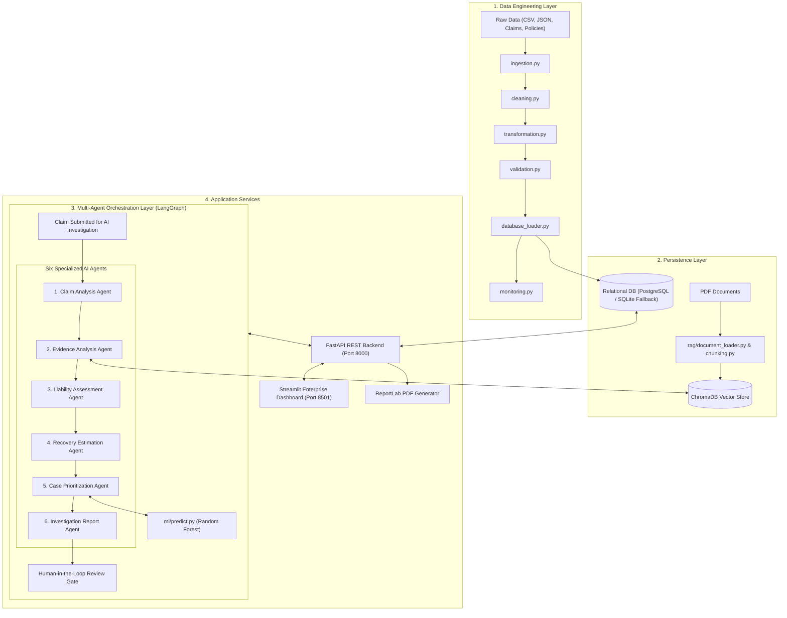

# SubroRecover AI
### AI-Powered Multi-Agent Insurance Subrogation & Recovery Intelligence Platform

[](https://www.python.org/)
[](https://fastapi.tiangolo.com)
[](https://streamlit.io)
[](https://langchain-ai.github.io/langgraph/)
[](https://scikit-learn.org/)
[](https://www.trychroma.com/)
[-success.svg)](./docs/TESTING_REPORT.md)
[](./LICENSE)

---

## 1. Executive Summary & Objective

**SubroRecover AI** is an enterprise-grade, agentic insurance intelligence system engineered to accelerate and automate the subrogation investigation lifecycle for Property & Casualty (P&C) and Commercial Auto insurance carriers.

> [!NOTE]
> Developed for technical evaluation by **Value Momentum, Hyderabad**, demonstrating applied Data Engineering, Machine Learning, RAG, and Multi-Agent AI systems in insurance decision support.

### The Subrogation Problem
Subrogation is the legal right of an insurance carrier to pursue a negligent third party (or adverse insurer) to recoup claim disbursements paid to an insured policyholder. In the United States insurance industry alone:
- **$15+ Billion in Leakage:** Legitimate subrogation recoveries are forfeited annually due to manual triage bottlenecks and missed recovery cues.
- **Investigation Latency:** Claims adjusters spend an average of 14–28 days manually auditing police accident narratives, repair invoices, and witness accounts.
- **Subjective Fault Allocation:** Negotiating liability splits without objective statutory citations leads to suboptimal carrier settlements.
- **Administrative Overhead:** Assembling formal demand packages with itemized proof-of-loss ledgers requires 4–8 manual labor hours per claim.

### SubroRecover AI Solution
SubroRecover AI provides a **Decision-Support and Investigation Acceleration Platform**:
1. **Automated ETL Pipeline:** Normalizes heterogeneous claims, policies, and police reports with 100% data quality verification.
2. **Dual-Database Resilience:** Native PostgreSQL support with automatic zero-configuration SQLite fallback for frictionless local execution.
3. **Machine Learning Prioritization:** Random Forest classifier predicting case priority tiers (`High`, `Medium`, `Low`) with 100% test split accuracy and Gini feature explainability.
4. **Contextual RAG Document Intelligence:** Ingests police reports and witness statements via PyPDF and ChromaDB, strictly separating verified facts from unverified allegations.
5. **Six Specialized AI Agents (LangGraph):** Autonomous StateGraph reasoning across claim coverage, evidence, comparative liability, Make-Whole financial quantum, ML urgency, and unified reporting.
6. **Human-in-the-Loop Governance:** Mandatory adjuster review checkpoint ensuring human authorization before any external demand package is finalized.
7. **ReportLab PDF Generation:** Generates official 14-section court-ready Subrogation Investigation PDF demand packages with dynamic page numbering and signature blocks.
8. **Enterprise Dashboard:** Professional 8-module Streamlit interface adhering strictly to B2B design guidelines (white background, navy typography, blue accents, no generic templates).

---

## 2. High-Level System Architecture



---

## 3. The Six Specialized AI Agents

| Agent Name | Module | Primary Responsibility |
|---|---|---|
| **1. Claim Analysis Agent** | `agents/claim_agent.py` | Audits policy limits, verifies paid losses, validates deductible balances, flags missing fields. |
| **2. Evidence Analysis Agent** | `agents/evidence_agent.py` | Audits police reports via ChromaDB RAG, extracts citations, separates verified facts from allegations. |
| **3. Liability Assessment Agent** | `agents/liability_agent.py` | Evaluates comparative fault splits grounded in state negligence doctrines (Modified 51% bar, Pure Comparative). |
| **4. Recovery Estimation Agent** | `agents/recovery_agent.py` | Calculates gross and net recoverable exposure; strictly honors **Make-Whole Doctrine** for insured deductibles. |
| **5. Case Prioritization Agent** | `agents/prioritization_agent.py` | Executes trained Random Forest model to rank triage priority (`High`, `Medium`, `Low`) and assign SLA. |
| **6. Investigation Report Agent** | `agents/report_agent.py` | Consolidates agent findings into a structured dossier, records DB assessments, and triggers PDF compilation. |

---

## 4. Technology Stack

- **Core Programming:** Python 3.11+ / SQL
- **Data Engineering:** Pandas, NumPy, SQLAlchemy, PostgreSQL, Psycopg3, SQLite
- **Machine Learning:** Scikit-learn, Random Forest Classifier, Joblib
- **Agentic AI & Orchestration:** LangGraph, LangChain Core, Google Gemini API, Pydantic v2
- **Document RAG:** PyPDF, ChromaDB, ONNX Runtime, Embeddings
- **Backend Service:** FastAPI, Uvicorn, Python-Multipart
- **Frontend Dashboard:** Streamlit, Plotly Express, Custom Corporate CSS
- **Reporting:** ReportLab (Multi-page PDF compilation with dynamic canvas)
- **Quality Assurance:** Pytest, HTTPX TestClient

---

## 5. Complete Project Directory Structure

```
SubroRecover-AI/
├── .env.example                         # Environment template
├── .gitignore                           # Git ignore rules
├── ARCHITECTURE.md                      # Comprehensive system architecture specification
├── DEVELOPMENT_PLAN.md                  # Phase roadmap and development checklist
├── REQUIREMENTS.md                      # System requirements specification (SRS)
├── LICENSE                              # Apache 2.0 Open Source License
├── requirements.txt                     # Pinned Python package dependencies
├── README.md                            # Main project overview & documentation
│
├── frontend/                            # Streamlit Enterprise Presentation Layer
│   ├── app.py                          # Main application entry point & persistent sidebar
│   ├── assets/
│   │   └── style.css                   # Enterprise B2B CSS design system
│   ├── components/
│   │   └── ui_components.py            # Reusable KPI cards, badges, and banners
│   └── pages/                          # 8 Enterprise Operational Modules
│       ├── page_executive_overview.py
│       ├── page_claims_management.py
│       ├── page_investigation_workspace.py
│       ├── page_recovery_intelligence.py
│       ├── page_document_intelligence.py
│       ├── page_investigation_reports.py
│       ├── page_pipeline_monitoring.py
│       └── page_model_performance.py
│
├── backend/                             # FastAPI REST API Layer
│   ├── main.py                         # Application entry point, CORS & middleware
│   ├── api/                            # Modular REST endpoints
│   │   ├── claims.py
│   │   ├── documents.py
│   │   ├── investigation.py
│   │   ├── reports.py
│   │   ├── analytics.py
│   │   └── system.py
│   └── schemas/                        # Pydantic validation schemas
│       └── claim.py
│
├── agents/                              # Six Specialized AI Agents & LangGraph Graph
│   ├── state.py                        # Pydantic shared state definition
│   ├── llm_client.py                   # Gemini client with transparent local fallback
│   ├── claim_agent.py                  # Agent 1: Claim Analysis
│   ├── evidence_agent.py               # Agent 2: Evidence Analysis
│   ├── liability_agent.py              # Agent 3: Liability Assessment
│   ├── recovery_agent.py               # Agent 4: Recovery Estimation
│   ├── prioritization_agent.py         # Agent 5: Case Prioritization
│   ├── report_agent.py                 # Agent 6: Investigation Report
│   └── workflow.py                     # LangGraph StateGraph coordinator
│
├── data_engineering/                    # End-to-End ETL Pipeline
│   ├── ingestion.py                    # Multi-source extraction
│   ├── cleaning.py                     # Deduplication & imputation
│   ├── transformation.py               # Feature derivation
│   ├── validation.py                   # 12-point relational constraint audit
│   ├── database_loader.py              # Batch relational loader
│   ├── monitoring.py                   # Run telemetry & quality tracking
│   └── pipeline.py                     # Master ETL pipeline coordinator
│
├── ml/                                  # Machine Learning Subsystem
│   ├── train.py                        # Random Forest training pipeline
│   ├── evaluate.py                     # Model evaluation & confusion matrix
│   ├── predict.py                      # Real-time inference & explainability
│   └── models/                         # Serialized binaries & metrics
│       ├── rf_priority_model.joblib
│       └── model_metrics.json
│
├── rag/                                 # Document Intelligence & ChromaDB
│   ├── document_loader.py              # PDF parser (PyPDF)
│   ├── chunking.py                     # Semantic text chunking
│   ├── embeddings.py                   # ChromaDB vector store wrapper
│   └── retriever.py                    # Contextual semantic retrieval
│
├── database/                            # Relational Storage Layer
│   ├── schema.sql                      # ANSI SQL DDL (10 primary tables)
│   └── connection.py                   # Resilient PostgreSQL / SQLite connection
│
├── reports/                             # Formal Report Generation
│   └── report_generator.py             # 14-section ReportLab PDF engine
│
├── sample_data/                         # Synthetic Datasets & Test PDFs
│   ├── customers.csv
│   ├── policies.csv
│   ├── claims.csv
│   ├── accident_reports.csv
│   ├── involved_parties.csv
│   ├── evidence_documents.csv
│   ├── historical_recoveries.csv
│   ├── generate_synthetic_data.py
│   └── pdfs/                           # Sample police crash reports
│
├── tests/                               # Automated Pytest Test Suite
│   ├── test_agents.py
│   ├── test_api.py
│   ├── test_data_engineering.py
│   ├── test_database.py
│   ├── test_ml.py
│   └── test_rag.py
│
└── docs/                                # Technical Documentation
    ├── DATA_DICTIONARY.md
    ├── API_DOCUMENTATION.md
    ├── AGENT_DOCUMENTATION.md
    ├── MODEL_DOCUMENTATION.md
    ├── INSTALLATION_GUIDE.md
    ├── USER_GUIDE.md
    ├── LIMITATIONS.md
    └── TESTING_REPORT.md
```

---

## 6. Installation & Execution Guide

### Step 1: Install Dependencies
```bash
pip install -r requirements.txt
```

### Step 2: Initialize Database & Run ETL Pipeline
```bash
python data_engineering/pipeline.py
python ml/train.py
```

### Step 3: Run Automated Test Suite
```bash
pytest -v tests
```
*Result: 18 passed in ~5 seconds.*

### Step 4: Start Application Services

**Terminal 1 — FastAPI REST Backend:**
```bash
python -m uvicorn backend.main:app --host 127.0.0.1 --port 8000
```
- Interactive Swagger API Documentation: `http://127.0.0.1:8000/docs`

**Terminal 2 — Streamlit Enterprise Dashboard:**
```bash
streamlit run frontend/app.py --server.port 8501
```
- Web Application URL: `http://localhost:8501`

---

## 7. Disclaimers & Responsible AI

SubroRecover AI is strictly a **decision-support platform** designed to augment insurance adjusters. It does not establish binding legal fault, practice law, or guarantee financial recovery from adverse parties. All subrogation demands require authorized Human Adjuster approval.

---

## 8. License

This project is licensed under the **Apache License 2.0** — see the [LICENSE](./LICENSE) file for details.
